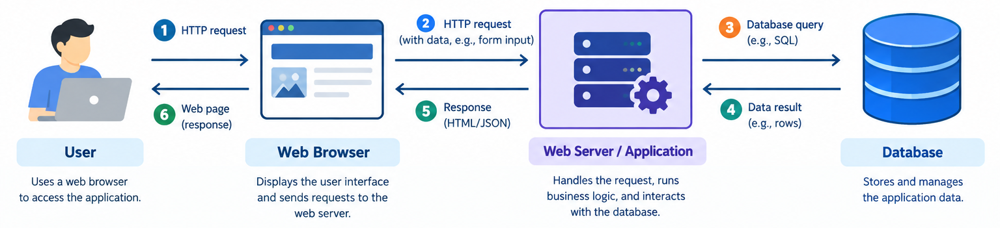
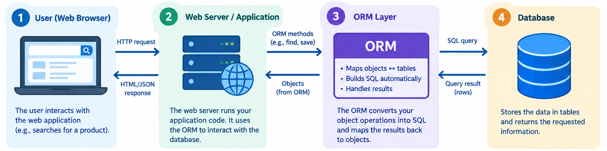

# Week 6: Database-Driven Web Apps and ORM

Every store we have used so far has had a weak spot. The `BOOKS` list in `catalog/data.py` disappears whenever the server restarts, and in production each worker process would hold its own copy. The session table survived restarts, but only because Django was quietly keeping it in a database. 

Databases solve all these problems at once: data outlives the process, every worker sees the same copy, concurrent writes are handled safely, and the database can answer questions without shipping everything back to us. This week we connect the bookstore to one, and we do it through an ORM so that our Python code keeps talking in objects rather than SQL strings.

## Relational Databases

A relational database stores data in tables. Each row is one record, each column holds one attribute, and every row has a primary key that identifies it uniquely. If you have worked with a hash table, the primary key plays the same role as the key: the database keeps an index on it so lookups don't need a full scan.

| id | title | author | price | in_stock |
|---|---|---|---|---|
| 1 | Django 5 by Example | Antonio Mele | 49.99 | true |
| 2 | Fluent Python | Luciano Ramalho | 59.99 | true |
| 3 | Clean Code | Robert C. Martin | 39.99 | false |

Tables relate to each other through foreign keys. An `order` table might have a `book_id` column holding a primary key from the `book` table. That one integer is how a relational database expresses "this order is for that book."



SQL is the language for talking to the database. The four operations behind every CRUD app look like this:

```sql
INSERT INTO book (title, author, price, in_stock) VALUES ('Clean Code', 'Robert C. Martin', 39.99, false);
SELECT title, price FROM book WHERE price < 50 ORDER BY price;
UPDATE book SET in_stock = true WHERE id = 3;
DELETE FROM book WHERE id = 3;
```

Notice the overlap with REST. Create, read, update, and delete map naturally onto POST, GET, PUT/PATCH, and DELETE, which is why so many APIs are thin layers over a table.

### Transactions

A transaction groups several statements so they either all happen or none do. The classic example is placing an order: insert the order row, reduce the stock count, charge the card. If the third step fails, you don't want the first two to stick. Databases guarantee this with the ACID properties: atomicity (all or nothing), consistency (constraints always hold), isolation (concurrent transactions don't see each other's half-finished work), and durability (once committed, it survives a crash). Our in-memory list offered none of these.

## Server-Side Scripting

Server-side scripting simply means code that runs on the server rather than in the browser. Every Django view we have written is server-side code. This week adds a second kind: scripts that run on the server but outside any HTTP request, such as creating tables, loading starter data, or nightly cleanup jobs. Django gives these a home as management commands, run with `python manage.py <name>`. You have been using built-in ones since Week 1 (`runserver`, `migrate`, `startapp`); this week we write our own.

## Object-Relational Mapping

Python thinks in objects with attributes and methods. The database thinks in tables, rows, and SQL. Translating between the two by hand means writing SQL strings, sending them, and unpacking rows into objects, over and over. This gap is often called the object-relational impedance mismatch.

An ORM (object-relational mapper) automates the translation:

| Database concept | ORM concept |
|---|---|
| Table | Model class |
| Column | Field (class attribute) |
| Row | Model instance (object) |
| Foreign key | Attribute that points to another object |
| `SELECT ... WHERE ...` | A query built with method calls |

The benefits are real: you write less repetitive code, the same code runs on SQLite, PostgreSQL, or MySQL, and query values are escaped for you, which closes off SQL injection. The costs are real too. An ORM can hide expensive queries behind innocent-looking attribute access, and some complex reports are clearer in plain SQL. Good developers use the ORM by default and still know how to read the SQL it produces, which is exactly what our exercises do.



## Configuring the ORM

Django's ORM is configured by one setting in `settings.py`:

```python
DATABASES = {
    "default": {
        "ENGINE": "django.db.backends.sqlite3",
        "NAME": BASE_DIR / "db.sqlite3",
    }
}
```

`ENGINE` picks the backend and `NAME` says where the data lives. SQLite keeps everything in one file and needs no server, which is ideal for learning. Switching to PostgreSQL in production changes this block, not your models or queries:

```python
DATABASES = {
    "default": {
        "ENGINE": "django.db.backends.postgresql",
        "NAME": "bookstore",
        "USER": "bookstore_user",
        "PASSWORD": "read-this-from-an-environment-variable",
        "HOST": "localhost",
        "PORT": "5432",
    }
}
```

| Backend | Good for | Extra install |
|---|---|---|
| SQLite | Development, small apps, tests | None (built into Python) |
| PostgreSQL | Most production Django sites | `psycopg` driver plus a database server |
| MySQL / MariaDB | Apps already running MySQL | `mysqlclient` driver plus a database server |

## Models Become Tables

A model is a Python class that subclasses `models.Model`. Each field becomes a column, and Django adds an auto-incrementing `id` primary key unless you say otherwise.

| Field type | Column it creates | Use it for |
|---|---|---|
| `CharField(max_length=...)` | varchar | Short text like titles and names |
| `TextField` | text | Long text |
| `IntegerField` | integer | Counts, quantities |
| `DecimalField(max_digits, decimal_places)` | decimal | Money |
| `BooleanField` | bool | Flags like `in_stock` |
| `DateTimeField` | datetime | Timestamps |
| `ForeignKey` | integer plus a constraint | A link to another table |

Money gets `DecimalField`, not `FloatField`, and the reason is easy to see in a Python shell: `0.1 + 0.2` gives `0.30000000000000004`, while `Decimal("0.1") + Decimal("0.2")` gives exactly `Decimal('0.3')`. Floats store binary approximations, so small errors pile up in totals. 

## Migrations

Changing a model doesn't change the database by itself. Django compares your models with the record of what it already built and writes a migration: a small Python file describing the change, such as "create table" or "add column." Two commands do the work:

- `python manage.py makemigrations` writes the migration file. Commit it to Git with your code, because it is the history of your schema.
- `python manage.py migrate` applies any migrations the database hasn't seen yet.

`python manage.py sqlmigrate <app> <number>` prints the SQL a migration will run without running it. That is our window into what the ORM does on our behalf.

## QuerySets

Every model gets a manager called `objects`, and the manager hands out QuerySets. A QuerySet describes a query; it doesn't run one until you actually need the results.

```python
in_stock = Book.objects.filter(in_stock=True)      # no SQL yet
cheap_first = in_stock.order_by("price")           # still no SQL
for book in cheap_first:                           # now one SELECT runs
    print(book.title)
```

This laziness lets you build a query in pieces, for example adding a filter only if the client sent `?in_stock=true`, and still send one efficient statement.

Filters use field lookups, written as the field name, two underscores, and an operator:

| Lookup | SQL it becomes |
|---|---|
| `price__lt=50` | `price < 50` |
| `price__gte=20` | `price >= 20` |
| `title__icontains="python"` | `title LIKE '%python%'` (case insensitive) |
| `author__startswith="R"` | `author LIKE 'R%'` |
| `id__in=[1, 2]` | `id IN (1, 2)` |

Aggregation asks the database to do the math, so only the answer travels back instead of every row:

```python
from django.db.models import Avg, Count, Q

Book.objects.aggregate(
    count=Count("id"),
    average_price=Avg("price"),
    in_stock=Count("id", filter=Q(in_stock=True)),
)
```

Compare that with last week's `compute_stats()`, which pulled every book into Python and looped. With a few books there is no difference; with a million rows, only one of these approaches is reasonable.

## Relationships and the N+1 Problem

Real data is connected. If authors had their own table, a book would point to one with a foreign key:

```python
class Author(models.Model):
    name = models.CharField(max_length=100)


class Book(models.Model):
    title = models.CharField(max_length=200)
    author = models.ForeignKey(Author, on_delete=models.PROTECT, related_name="books")
```

`book.author.name` follows the link forward, and `author.books.all()` follows it backward. `on_delete` decides what happens to books when their author is deleted: `PROTECT` refuses, `CASCADE` deletes the books too, `SET_NULL` clears the link. Many-to-many relationships, such as books and genres, use `ManyToManyField`, which Django backs with a hidden join table.

That convenient attribute access hides a classic performance trap. This loop looks like one query:

```python
for book in Book.objects.all():
    print(book.title, book.author.name)
```

It is actually one query for the books plus one more for each book's author: N+1 queries. With 500 books, that's 501 round trips. The fix is to tell the ORM what you'll need up front:

```python
for book in Book.objects.select_related("author"):
    print(book.title, book.author.name)   # one query with a JOIN
```

`select_related` handles forward foreign keys with a SQL JOIN; `prefetch_related` handles reverse and many-to-many links with one extra query. The same idea of fetching in bulk instead of one row at a time shows up in Exercise 2, where the cart uses `in_bulk()`. This week's bonus lets you watch the N+1 problem happen and then fix it.

## Raw SQL and Parameters

The ORM doesn't take SQL away from you. `Model.objects.raw()` runs your SQL and still returns model objects, and `connection.cursor()` gives you plain rows. Either way, never build SQL by pasting user input into the string:

```python
# Dangerous: the input becomes part of the SQL itself
cursor.execute(f"SELECT * FROM catalog_book WHERE title = '{title}'")

# Safe: the database receives the value separately from the statement
cursor.execute("SELECT * FROM catalog_book WHERE title = %s", [title])
```

If someone submits `' OR '1'='1` as a title, the first version returns every row. The second searches for a book with that odd name. ORM queries always use the safe form.

## The ORM in MVC and N-Tier Terms

Until now our Model was a Python list pretending to be that tier. This week the data tier becomes a real database, and the model class is the boundary: views ask the model for data, and only the ORM speaks SQL.

That boundary matters for services too. In Week 3 we said a service hides its implementation behind a contract. Exercise 2 puts that to the test: we swap the storage underneath the API, and the clients we wrote in earlier weeks shouldn't notice.

## Exercise 1: From a List to a Table

We'll give the bookstore a `Book` model, create its table, load the starter books with our own management command, and then query and change the data from the Django shell, reading the SQL along the way. The API keeps using `data.py` until Exercise 2, so nothing breaks in the meantime.

Open a terminal in the `bookstore` project folder (the one with `manage.py`) and activate your virtual environment.

### Step 1: Check the database settings

Open `bookstore/settings.py` and find `DATABASES`. It should still be the default Django created back in Week 3:

```python
DATABASES = {
    "default": {
        "ENGINE": "django.db.backends.sqlite3",
        "NAME": BASE_DIR / "db.sqlite3",
    }
}
```

`db.sqlite3` already exists next to `manage.py`. It has held the session table since Week 5, which is why the cart survived server restarts.

### Step 2: Define the model

Replace the contents of `catalog/models.py` (Django created it empty when we ran `startapp`):

```python
# catalog/models.py
from django.db import models


class Book(models.Model):
    title = models.CharField(max_length=200)
    author = models.CharField(max_length=100)
    price = models.DecimalField(max_digits=6, decimal_places=2)
    in_stock = models.BooleanField(default=True)

    class Meta:
        ordering = ["id"]

    def __str__(self):
        return f"{self.title} (${self.price})"

    def as_dict(self):
        return {
            "id": self.id,
            "title": self.title,
            "author": self.author,
            "price": float(self.price),
            "in_stock": self.in_stock,
        }
```

The fields match the keys in `BOOKS`, minus `id`, which Django adds for us. `max_digits=6, decimal_places=2` allows prices up to 9999.99. `Meta.ordering` gives every query a predictable order, the way the list always had one. `__str__` controls how a book prints in the shell. `as_dict` is a small helper that turns the price back into a JSON number, since Django's `JsonResponse` would otherwise send a `Decimal` as a string.

### Step 3: Create and inspect the migration

```bash
python manage.py makemigrations catalog
python manage.py sqlmigrate catalog 0001
python manage.py migrate
```

Expected output, in order:

```
Migrations for 'catalog':
  catalog/migrations/0001_initial.py
    - Create model Book
```

Django 6 marks the operation with `+` instead of `-`.

```
BEGIN;
--
-- Create model Book
--
CREATE TABLE "catalog_book" ("id" integer NOT NULL PRIMARY KEY AUTOINCREMENT, "title" varchar(200) NOT NULL, "author" varchar(100) NOT NULL, "price" decimal NOT NULL, "in_stock" bool NOT NULL);
COMMIT;
```

```
Operations to perform:
  Apply all migrations: admin, auth, catalog, contenttypes, sessions
Running migrations:
  Applying catalog.0001_initial... OK
```

Read the `CREATE TABLE` line against the model. The table name is the app name plus the model name, `catalog_book`. Every field became a column, `max_length` became `varchar(200)`, and the `id` primary key appeared on its own. Open `catalog/migrations/0001_initial.py` too: it is ordinary Python, and it belongs in Git with the rest of your code.

### Step 4: Load the starter data with a management command

The table is empty. We'll write a server-side script that copies the three books from `data.py` into it. Django looks for custom commands in a specific folder structure, so create these folders and two empty files inside `catalog`:

```
catalog/
    management/
        __init__.py
        commands/
            __init__.py
            seed_books.py
```

Then write `catalog/management/commands/seed_books.py`:

```python
# catalog/management/commands/seed_books.py
from django.core.management.base import BaseCommand

from catalog.data import BOOKS
from catalog.models import Book


class Command(BaseCommand):
    help = "Copy the starter books from catalog/data.py into the database."

    def handle(self, *args, **options):
        for item in BOOKS:
            book, created = Book.objects.get_or_create(
                title=item["title"],
                defaults={
                    "author": item["author"],
                    "price": str(item["price"]),
                    "in_stock": item["in_stock"],
                },
            )
            label = "created" if created else "already there"
            self.stdout.write(f"{label:>13}: {book}")
        self.stdout.write(f"Total books in database: {Book.objects.count()}")
```

The file name becomes the command name. `get_or_create` looks for a book with that title and only inserts one if none exists, returning the object plus a flag saying which happened. That makes the script safe to run twice. The price goes in as `str(item["price"])` so the decimal is built from the text "49.99" rather than from a float's binary approximation.

Run it twice:

```bash
python manage.py seed_books
python manage.py seed_books
```

Expected output:

```
      created: Django 5 by Example ($49.99)
      created: Fluent Python ($59.99)
      created: Clean Code ($39.99)
Total books in database: 3
```

```
already there: Django 5 by Example ($49.99)
already there: Fluent Python ($59.99)
already there: Clean Code ($39.99)
Total books in database: 3
```

### Step 5: Query the data from the shell

```bash
python manage.py shell
```

Type or copy paste the below code in the shell which helps in checking that everything is in place.

```python
from django.db.models import Avg, Count
from catalog.models import Book
Book.objects.all()
Book.objects.filter(in_stock=True)
Book.objects.filter(price__lt=50).order_by("-price")
Book.objects.get(pk=2)
Book.objects.filter(title__icontains="python").values_list("title", "price")
Book.objects.aggregate(avg=Avg("price"), n=Count("id"))
```

Expected output, one result per query:

```text
<QuerySet [<Book: Django 5 by Example ($49.99)>, <Book: Fluent Python ($59.99)>, <Book: Clean Code ($39.99)>]>
<QuerySet [<Book: Django 5 by Example ($49.99)>, <Book: Fluent Python ($59.99)>]>
<QuerySet [<Book: Django 5 by Example ($49.99)>, <Book: Clean Code ($39.99)>]>
<Book: Fluent Python ($59.99)>
<QuerySet [('Fluent Python', Decimal('59.99'))]>
{'avg': Decimal('49.9900000000000'), 'n': 3}
```

`get` returns a single object and raises `Book.DoesNotExist` if nothing matches. `order_by("-price")` sorts descending, the database version of the `sorted(..., key=...)` call. `values_list` fetches only the columns you name. The prices come back as `Decimal`, and SQLite's average carries extra trailing zeros, which is why our views will round it.

Now look at the SQL and at when it runs (this runs in the shell as well):

```python
from django.db import connection, reset_queries
qs = Book.objects.filter(in_stock=True).order_by("-price")
print(qs.query)
reset_queries()
qs = Book.objects.filter(in_stock=True)
len(connection.queries)
books = list(qs)
len(connection.queries)
```

Expected output:

```text
SELECT "catalog_book"."id", "catalog_book"."title", "catalog_book"."author", "catalog_book"."price", "catalog_book"."in_stock" FROM "catalog_book" WHERE "catalog_book"."in_stock" = True ORDER BY "catalog_book"."price" DESC
0
1
```

The exact SQL text varies a little between Django versions. `connection.queries` is a log Django keeps while `DEBUG = True`. Building the QuerySet ran nothing; turning it into a list ran exactly one query.

### Step 6: Create, update, delete, and roll back

Stay in the same shell:

```python
from django.db import transaction
temp = Book.objects.create(title="Temp Book", author="Nobody", price="9.50")
temp, temp.id
temp.price = "12.00"
temp.save()
Book.objects.get(pk=temp.id).price
Book.objects.filter(author="Nobody").update(in_stock=False)
temp.delete()
Book.objects.count()
```

Expected output:

```text
(<Book: Temp Book ($9.50)>, 4)
Decimal('12.00')
1
(1, {'catalog.Book': 1})
3
```

`create` runs an INSERT and returns the saved object with its new `id`. Changing an attribute does nothing until `save()` runs an UPDATE. `QuerySet.update` changes every matching row in a single UPDATE without loading them first, and returns how many rows it touched. `delete` returns how many rows went, per model.

Now a transaction that fails halfway. This is a multi-line block, so paste it on its own and press Enter on the empty line that follows to run it:

```python
try:
    with transaction.atomic():
        half = Book.objects.create(title="Half Saved", author="Nobody", price="5.00")
        raise ValueError("something failed halfway")
except ValueError as e:
    print("Rolled back:", e)

```

Then check whether the book exists:

```python
Book.objects.filter(title="Half Saved").exists()
```

Expected output:

```text
Rolled back: something failed halfway
False
```

The INSERT really ran, but the error inside `atomic()` rolled it back, so the book never became permanent. Wrap any group of writes that must succeed or fail together this way.

### Step 7: Drop down to raw SQL

Still in the same shell, paste each block on its own and press Enter on the empty line after it:

```python
with connection.cursor() as cursor:
    cursor.execute("SELECT title, price FROM catalog_book WHERE price < %s ORDER BY price", [50])
    print(cursor.fetchall())

```

```python
for book in Book.objects.raw("SELECT * FROM catalog_book WHERE in_stock = %s", [True]):
    print(book.id, book.title)

```

Expected output:

```text
<django.db.backends.sqlite3.base.SQLiteCursorWrapper object at 0x...>
[('Clean Code', 39.99), ('Django 5 by Example', 49.99)]
1 Django 5 by Example
2 Fluent Python
```

The shell echoes the cursor object because `execute` returns it; the memory address will differ on your machine, so ignore that line. Two things to notice. Both queries pass the value separately through `%s`, never pasted into the string. And the cursor gave back prices as plain floats, because SQLite has no true decimal type and raw SQL skips the model's field conversion; the ORM queries in Step 5 handed us `Decimal`. That conversion is part of what the ORM does for you.

Type `exit()` to leave the shell. The data is still there next time, because it lives in `db.sqlite3`, not in the shell process.

## Exercise 2: Moving the API onto the Database

Four files still import from `catalog/data.py`: `rest_views.py`, `api_views.py`, `state_views.py`, and `cache_views.py`. We'll switch each one to the `Book` model. The URLs, field names, and JSON types clients see must not change.

We'll change one part of the API at a time and test it straight away with a client script that grows as we go. Every code change is a find-and-replace pair: find the lines in the first block and replace them with the second block. Any line not mentioned stays as it is. The finished file follows each list, so you can compare yours against it line by line. If your Week 4 or Week 5 code differs slightly from the notes, for example in the wording of an error message, match on the code and keep your wording.

Before you start, check one line from Exercise 1. In `catalog/models.py`, `as_dict()` must return `"price": float(self.price)`, not `self.price`. Otherwise the REST views below will send prices as strings and break the contract.

### Step 1: Start the test client

Start the server with `python manage.py runserver` and leave it running for the whole exercise. Whenever you save a `.py` file, `runserver` reloads itself, so each change goes live as soon as you save. Finish all the edits in a step before you run the client, because a half-edited file can stop the server from reloading.

Open a second terminal in the same folder, activate the virtual environment, and create `db_client.py` next to `manage.py`:

```python
# db_client.py
import sys

import requests

BASE = "http://127.0.0.1:8000/api"
part = sys.argv[1] if len(sys.argv) > 1 else ""
```

Each step below adds one `if` block to the bottom of this file, and you run just that block by naming it: `python db_client.py rest`, `python db_client.py v2`, and so on. Running one part at a time matters now that the data is permanent. If every run repeated every earlier POST, the database would fill up with copies of the same books.

### Step 2: Update the REST views

Open `catalog/rest_views.py`. It should match Week 4's code plus the Week 5 `invalidate_stats()` call after the append. Make six changes.

1. Swap the data import for the model. Leave the `invalidate_stats` import as it is. Find:

```python
from .data import BOOKS, find_book, next_id
```

Replace with:

```python
from .models import Book
```

2. In the GET branch of `book_list`, build the list from the database. Find:

```python
        return JsonResponse(BOOKS, safe=False)
```

Replace with:

```python
        return JsonResponse([book.as_dict() for book in Book.objects.all()], safe=False)
```

3. In the POST branch, replace the dictionary and the append with a database insert. Keep `invalidate_stats()` after the write. Find:

```python
    book = {
        "id": next_id(),
        "title": payload["title"],
        "author": payload["author"],
        "price": float(payload["price"]),
        "in_stock": payload.get("in_stock", True),
    }
    BOOKS.append(book)
    invalidate_stats()
```

Replace with:

```python
    book = Book.objects.create(
        title=payload["title"],
        author=payload["author"],
        price=str(payload["price"]),
        in_stock=payload.get("in_stock", True),
    )
    book.refresh_from_db()
    invalidate_stats()
```

4. Turn the new book into a dictionary for the response, and read its ID as an attribute. Find:

```python
    response = JsonResponse(book, status=201)
    response["Location"] = f"/api/books/{book['id']}/"
```

Replace with:

```python
    response = JsonResponse(book.as_dict(), status=201)
    response["Location"] = f"/api/books/{book.id}/"
```

5. In `book_detail`, look the book up in the database. Find:

```python
    book = find_book(book_id)
```

Replace with:

```python
    book = Book.objects.filter(pk=book_id).first()
```

6. Still in `book_detail`, convert the book before returning it. Find:

```python
    return JsonResponse(book)
```

Replace with:

```python
    return JsonResponse(book.as_dict())
```

The finished file:

```python
# catalog/rest_views.py
import json

from django.http import JsonResponse
from django.views.decorators.csrf import csrf_exempt
from django.views.decorators.http import require_http_methods

from .cache_views import invalidate_stats
from .models import Book


@csrf_exempt
@require_http_methods(["GET", "POST"])
def book_list(request):
    if request.method == "GET":
        return JsonResponse([book.as_dict() for book in Book.objects.all()], safe=False)

    try:
        payload = json.loads(request.body)
    except json.JSONDecodeError:
        return JsonResponse({"error": "Body must be valid JSON."}, status=400)

    missing = [f for f in ("title", "author", "price") if f not in payload]
    if missing:
        return JsonResponse({"error": f"Missing fields: {', '.join(missing)}"}, status=400)

    book = Book.objects.create(
        title=payload["title"],
        author=payload["author"],
        price=str(payload["price"]),
        in_stock=payload.get("in_stock", True),
    )
    book.refresh_from_db()
    invalidate_stats()

    response = JsonResponse(book.as_dict(), status=201)
    response["Location"] = f"/api/books/{book.id}/"
    return response


@require_http_methods(["GET"])
def book_detail(request, book_id):
    book = Book.objects.filter(pk=book_id).first()
    if book is None:
        return JsonResponse({"error": "Book not found."}, status=404)
    return JsonResponse(book.as_dict())
```

`refresh_from_db()` reloads the row we just inserted, so the response shows what the database actually stored (a `Decimal` rounded to two places) rather than whatever the client sent. `filter(...).first()` returns `None` when nothing matches, a handy alternative to catching `DoesNotExist`.

Now test it. Add this to the bottom of `db_client.py`:

```python
if part == "rest":
    print("list:")
    for book in requests.get(f"{BASE}/books/").json():
        print("  ", book)
    print("detail:", requests.get(f"{BASE}/books/2/").json())
    r = requests.get(f"{BASE}/books/99/")
    print("missing:", r.status_code, r.json())
    r = requests.post(f"{BASE}/books/", json={
        "title": "Two Scoops of Django",
        "author": "Daniel and Audrey Feldroy",
        "price": 44.95,
    })
    print("POST:", r.status_code, r.headers.get("Location"), r.json())
    print("books in database:", len(requests.get(f"{BASE}/books/").json()))
    print("books v2 can see:", len(requests.get(f"{BASE}/v2/books/").json()))
```

Run `python db_client.py rest`. Expected output:

```text
list:
   {'id': 1, 'title': 'Django 5 by Example', 'author': 'Antonio Mele', 'price': 49.99, 'in_stock': True}
   {'id': 2, 'title': 'Fluent Python', 'author': 'Luciano Ramalho', 'price': 59.99, 'in_stock': True}
   {'id': 3, 'title': 'Clean Code', 'author': 'Robert C. Martin', 'price': 39.99, 'in_stock': False}
detail: {'id': 2, 'title': 'Fluent Python', 'author': 'Luciano Ramalho', 'price': 59.99, 'in_stock': True}
missing: 404 {'error': 'Book not found.'}
POST: 201 /api/books/5/ {'id': 5, 'title': 'Two Scoops of Django', 'author': 'Daniel and Audrey Feldroy', 'price': 44.95, 'in_stock': True}
books in database: 4
books v2 can see: 3
```

The JSON looks exactly like Weeks 4 and 5: same keys, prices as numbers, the same 404 body. That's the contract holding, even though the data now comes from a table.

The new book's ID is 5, not 4. The Temp Book from Exercise 1 used ID 4 before we deleted it. SQLite's `AUTOINCREMENT` never hands out an ID twice, and PostgreSQL sequences behave the same way. That's deliberate: if an old link or a cart still pointed at ID 4, reusing it would silently point at the wrong book. Clients should treat IDs as opaque labels, never as counts or positions. If you skipped the Temp Book step, your IDs in this exercise will be one lower.

Look at the last two lines. The database has four books, but the DRF views still read the `BOOKS` list, so they only see three. Two copies of the same data that disagree is exactly the problem a single database is meant to solve. The next two steps fix it.

### Step 3: Switch to a ModelSerializer

First, add this to the bottom of `bookstore/settings.py`:

```python
REST_FRAMEWORK = {
    "COERCE_DECIMAL_TO_STRING": False,
}
```

By default, DRF sends a `DecimalField` as a JSON string, `"49.99"`, so no precision is lost on the way to the client. That's a defensible choice for a new API, but our v2 contract already promised a number, and quietly turning it into a string would break every client doing math with it.

Then open `catalog/serializers.py` and make three changes.

1. Import the model. Find:

```python
from rest_framework import serializers
```

Replace with:

```python
from rest_framework import serializers

from .models import Book
```

2. Change the base class. Find:

```python
class BookSerializer(serializers.Serializer):
```

Replace with:

```python
class BookSerializer(serializers.ModelSerializer):
```

3. Delete the five hand-written fields and put a `Meta` class in their place. Find:

```python
    id = serializers.IntegerField(read_only=True)
    title = serializers.CharField(max_length=200)
    author = serializers.CharField(max_length=100)
    price = serializers.FloatField(min_value=0)
    in_stock = serializers.BooleanField(default=True)
```

Replace with:

```python
    class Meta:
        model = Book
        fields = ["id", "title", "author", "price", "in_stock"]
        extra_kwargs = {"price": {"min_value": 0}}
```

The finished file:

```python
# catalog/serializers.py
from rest_framework import serializers

from .models import Book


class BookSerializer(serializers.ModelSerializer):
    class Meta:
        model = Book
        fields = ["id", "title", "author", "price", "in_stock"]
        extra_kwargs = {"price": {"min_value": 0}}
```

`ModelSerializer` reads the model and generates the fields we typed by hand in Week 4: `max_length` comes from the `CharField`s, `id` is read-only because it is the primary key, `in_stock` is optional because the model has a default, and `price` becomes a `DecimalField` that rejects more than two decimal places. `extra_kwargs` adds the one rule the model doesn't express, no negative prices. The model is now the single source of truth for the data's shape.

There is nothing to test yet. The serializer is only used by `api_views.py`, which still hands it dictionaries from the list. Step 4 completes the pair.

### Step 4: Update the views

Open `catalog/api_views.py` and make five changes.

1. Swap the data import for the model and the cache helper. Find:

```python
from .data import BOOKS, find_book, next_id
```

Replace with:

```python
from .cache_views import invalidate_stats
from .models import Book
```

2. In `BookListAPI.get`, serialize the queryset instead of the list. Find:

```python
        serializer = BookSerializer(BOOKS, many=True)
```

Replace with:

```python
        serializer = BookSerializer(Book.objects.all(), many=True)
```

3. In `BookListAPI.post`, let the serializer save the book. Find:

```python
        book = {"id": next_id(), **serializer.validated_data}
        BOOKS.append(book)
```

Replace with:

```python
        book = serializer.save()
        invalidate_stats()
```

4. Still in `post`, the new book is an object now, not a dictionary. Find:

```python
            headers={"Location": f"/api/v2/books/{book['id']}/"},
```

Replace with:

```python
            headers={"Location": f"/api/v2/books/{book.id}/"},
```

5. In `BookDetailAPI.get`, look the book up in the database. Find:

```python
        book = find_book(book_id)
        if book is None:
            raise NotFound("Book not found.")
```

Replace with:

```python
        try:
            book = Book.objects.get(pk=book_id)
        except Book.DoesNotExist:
            raise NotFound("Book not found.")
```

The finished file:

```python
# catalog/api_views.py
from rest_framework import status
from rest_framework.exceptions import NotFound
from rest_framework.response import Response
from rest_framework.views import APIView

from .cache_views import invalidate_stats
from .models import Book
from .serializers import BookSerializer


class BookListAPI(APIView):
    def get(self, request):
        serializer = BookSerializer(Book.objects.all(), many=True)
        return Response(serializer.data)

    def post(self, request):
        serializer = BookSerializer(data=request.data)
        serializer.is_valid(raise_exception=True)

        book = serializer.save()
        invalidate_stats()

        return Response(
            BookSerializer(book).data,
            status=status.HTTP_201_CREATED,
            headers={"Location": f"/api/v2/books/{book.id}/"},
        )


class BookDetailAPI(APIView):
    def get(self, request, book_id):
        try:
            book = Book.objects.get(pk=book_id)
        except Book.DoesNotExist:
            raise NotFound("Book not found.")
        return Response(BookSerializer(book).data)
```

If you did the Week 4 bonus and added `patch`, `delete`, or an `?in_stock=` filter, those methods still use `BOOKS` and `find_book`, which this file no longer imports. They will fail with a `NameError` when called. Comment them out for now, or convert them yourself: `Book.objects.filter(in_stock=True)`, `serializer.save()` with `BookSerializer(book, data=request.data, partial=True)`, and `book.delete()`.

`serializer.save()` calls `Book.objects.create` with the validated data and returns the new book, so `next_id()` is gone: the database assigns IDs. The POST now invalidates the stats cache too. We catch `DoesNotExist` and raise our own `NotFound` rather than using a shortcut like `get_object_or_404`, because the shortcut's message is different, and the 404 body is part of the contract.

Now test it. Add this to the bottom of `db_client.py`:

```python
if part == "v2":
    books = requests.get(f"{BASE}/v2/books/").json()
    print("books v2 can see:", len(books))
    print("newest:", books[-1])
    print("missing:", requests.get(f"{BASE}/v2/books/99/").json())
    r = requests.post(f"{BASE}/v2/books/", json={"title": "Bad Price", "author": "X", "price": "abc"})
    print("bad price:", r.status_code, r.json())
    r = requests.post(f"{BASE}/v2/books/", json={"title": "Too Precise", "author": "X", "price": 12.345})
    print("three decimals:", r.status_code, r.json())
    r = requests.post(f"{BASE}/v2/books/", json={
        "title": "Effective Python",
        "author": "Brett Slatkin",
        "price": 39.99,
    })
    print("good POST:", r.status_code, r.headers.get("Location"), r.json())
```

Run `python db_client.py v2`. Expected output:

```text
books v2 can see: 4
newest: {'id': 5, 'title': 'Two Scoops of Django', 'author': 'Daniel and Audrey Feldroy', 'price': 44.95, 'in_stock': True}
missing: {'detail': 'Book not found.'}
bad price: 400 {'price': ['A valid number is required.']}
three decimals: 400 {'price': ['Ensure that there are no more than 2 decimal places.']}
good POST: 201 /api/v2/books/6/ {'id': 6, 'title': 'Effective Python', 'author': 'Brett Slatkin', 'price': 39.99, 'in_stock': True}
```

v2 now sees all four books, including the one v1 created in Step 2, and both versions agree because both read the same table. The 404 and the `"abc"` error bodies are the same as Week 4. The three-decimal price is a new rule we never wrote: `ModelSerializer` took it from `decimal_places=2` on the model. The good POST left out `in_stock`, and the response shows `True`, the model's default.

### Step 5: Update the cart

This time, test before you change anything. Add this to the bottom of `db_client.py`:

```python
if part == "cart":
    newest = requests.get(f"{BASE}/books/").json()[-1]
    shopper = requests.Session()
    shopper.post(f"{BASE}/cart/", json={"book_id": 1, "quantity": 2})
    shopper.post(f"{BASE}/cart/", json={"book_id": 2})
    r = shopper.post(f"{BASE}/cart/", json={"book_id": newest["id"]})
    print("add book", newest["id"], "->", r.status_code)
    print("cart:", shopper.get(f"{BASE}/cart/").json())
```

Run `python db_client.py cart`. Expected output:

```text
add book 6 -> 404
cart: {'items': [{'book_id': 1, 'title': 'Django 5 by Example', 'quantity': 2, 'line_total': 99.98}, {'book_id': 2, 'title': 'Fluent Python', 'quantity': 1, 'line_total': 59.99}], 'total': 159.97}
```

The cart still checks books against the `BOOKS` list, which has never heard of Effective Python, so it answers 404 and the cart holds only the first two books. Now fix the view.

Open `catalog/state_views.py` and make four changes. `visit_counter` doesn't touch the catalog, so it stays exactly as it is.

1. Add the `Decimal` import. Find:

```python
import json
```

Replace with:

```python
import json
from decimal import Decimal
```

2. Swap the data import for the model. Find:

```python
from .data import find_book
```

Replace with:

```python
from .models import Book
```

3. Replace the whole `cart_payload` function. Find:

```python
def cart_payload(cart):
    items, total = [], 0.0
    for book_id, quantity in cart.items():
        book = find_book(int(book_id))
        if book is None:
            continue
        line_total = book["price"] * quantity
        total += line_total
        items.append({"book_id": book["id"], "title": book["title"],
                      "quantity": quantity, "line_total": round(line_total, 2)})
    return {"items": items, "total": round(total, 2)}
```

Replace with:

```python
def cart_payload(cart):
    books = Book.objects.in_bulk([int(book_id) for book_id in cart])
    items, total = [], Decimal("0")
    for book_id, quantity in cart.items():
        book = books.get(int(book_id))
        if book is None:
            continue
        line_total = book.price * quantity
        total += line_total
        items.append({"book_id": book.id, "title": book.title,
                      "quantity": quantity, "line_total": float(line_total)})
    return {"items": items, "total": float(total)}
```

4. In the POST branch of `cart_view`, check the database for the book. Find:

```python
        if find_book(book_id) is None:
```

Replace with:

```python
        if not Book.objects.filter(pk=book_id).exists():
```

The finished file:

```python
# catalog/state_views.py
import json
from decimal import Decimal

from django.http import HttpResponse, JsonResponse
from django.views.decorators.csrf import csrf_exempt
from django.views.decorators.http import require_GET, require_http_methods

from .models import Book


@require_GET
def visit_counter(request):
    try:
        visits = int(request.COOKIES.get("visits", 0)) + 1
    except ValueError:
        visits = 1
    response = JsonResponse({"visits": visits})
    response.set_cookie("visits", str(visits),
                        max_age=60 * 60 * 24, httponly=True, samesite="Lax")
    return response


CART_KEY = "cart"


def cart_payload(cart):
    books = Book.objects.in_bulk([int(book_id) for book_id in cart])
    items, total = [], Decimal("0")
    for book_id, quantity in cart.items():
        book = books.get(int(book_id))
        if book is None:
            continue
        line_total = book.price * quantity
        total += line_total
        items.append({"book_id": book.id, "title": book.title,
                      "quantity": quantity, "line_total": float(line_total)})
    return {"items": items, "total": float(total)}


@csrf_exempt
@require_http_methods(["GET", "POST", "DELETE"])
def cart_view(request):
    cart = request.session.get(CART_KEY, {})

    if request.method == "POST":
        try:
            data = json.loads(request.body)
            book_id = int(data["book_id"])
            quantity = int(data.get("quantity", 1))
        except (ValueError, KeyError, TypeError):
            return JsonResponse({"error": "book_id and an integer quantity are required"}, status=400)
        if not Book.objects.filter(pk=book_id).exists():
            return JsonResponse({"error": "Book not found"}, status=404)

        key = str(book_id)
        cart[key] = cart.get(key, 0) + quantity
        request.session[CART_KEY] = cart

    elif request.method == "DELETE":
        request.session.pop(CART_KEY, None)
        return HttpResponse(status=204)

    return JsonResponse(cart_payload(cart))
```

`in_bulk` takes a list of IDs and returns a dictionary of `{id: Book}` from a single query. Calling `Book.objects.get` inside the loop would work, but it would be the N+1 pattern: one query per cart line. The totals are now exact `Decimal` arithmetic, converted to numbers only at the edge, when they become JSON. That conversion also replaces the old `round(..., 2)` calls: `Decimal` values with two decimal places need no rounding. `exists()` asks the database a yes-or-no question without loading the row.

Notice the cart itself hasn't moved. It still lives in the session, keyed by book ID, and prices are still looked up fresh. The session already lived in the database; now the catalog does too.

Save, and run `python db_client.py cart` again. Each run uses a fresh `requests.Session`, so it starts with an empty cart. Expected output:

```text
add book 6 -> 200
cart: {'items': [{'book_id': 1, 'title': 'Django 5 by Example', 'quantity': 2, 'line_total': 99.98}, {'book_id': 2, 'title': 'Fluent Python', 'quantity': 1, 'line_total': 59.99}, {'book_id': 6, 'title': 'Effective Python', 'quantity': 1, 'line_total': 39.99}], 'total': 199.96}
```

The arithmetic checks out: 2 × 49.99 + 59.99 + 39.99 = 199.96.

### Step 6: Update the stats

Again, test first. Add this to the bottom of `db_client.py`:

```python
if part == "stats":
    for _ in range(2):
        r = requests.get(f"{BASE}/stats/")
        print("stats:", r.headers.get("X-Cache"), r.json())
```

Run `python db_client.py stats`. Expected output:

```text
stats: MISS {'count': 3, 'average_price': 49.99, 'in_stock': 2}
stats: HIT {'count': 3, 'average_price': 49.99, 'in_stock': 2}
```

Each `stats` line takes about two seconds on a MISS because of the deliberate `sleep`. The numbers describe the three books in the `BOOKS` list, not the five in the database. Now fix the view.

Open `catalog/cache_views.py` and make three changes. Only `compute_stats` and the imports change; the three views and `invalidate_stats` stay as they are.

1. Import the aggregation helpers. Find:

```python
from django.core.cache import cache
```

Replace with:

```python
from django.core.cache import cache
from django.db.models import Avg, Count, Q
```

2. Swap the data import for the model. Find:

```python
from .data import BOOKS
```

Replace with:

```python
from .models import Book
```

3. Replace the whole `compute_stats` function. Find:

```python
def compute_stats():
    time.sleep(2)  # stands in for a slow query or a call to another service
    prices = [book["price"] for book in BOOKS]
    return {
        "count": len(BOOKS),
        "average_price": round(sum(prices) / len(prices), 2) if prices else 0,
        "in_stock": sum(1 for book in BOOKS if book["in_stock"]),
    }
```

Replace with:

```python
def compute_stats():
    time.sleep(2)  # still here so the cache demo from Week 5 keeps working
    stats = Book.objects.aggregate(
        count=Count("id"),
        average_price=Avg("price"),
        in_stock=Count("id", filter=Q(in_stock=True)),
    )
    average = stats["average_price"]
    stats["average_price"] = round(float(average), 2) if average is not None else 0
    return stats
```

The finished file:

```python
# catalog/cache_views.py
import time

from django.core.cache import cache
from django.db.models import Avg, Count, Q
from django.http import JsonResponse
from django.views.decorators.cache import cache_page
from django.views.decorators.http import require_GET

from .models import Book

STATS_KEY = "catalog:stats"


def compute_stats():
    time.sleep(2)  # still here so the cache demo from Week 5 keeps working
    stats = Book.objects.aggregate(
        count=Count("id"),
        average_price=Avg("price"),
        in_stock=Count("id", filter=Q(in_stock=True)),
    )
    average = stats["average_price"]
    stats["average_price"] = round(float(average), 2) if average is not None else 0
    return stats


def invalidate_stats():
    cache.delete(STATS_KEY)


@require_GET
def stats_uncached(request):
    return JsonResponse(compute_stats())


@require_GET
@cache_page(60)
def stats_page_cached(request):
    return JsonResponse(compute_stats())


@require_GET
def stats_low_level(request):
    data = cache.get(STATS_KEY)
    hit = data is not None
    if not hit:
        data = compute_stats()
        cache.set(STATS_KEY, data, timeout=300)
    response = JsonResponse(data)
    response["X-Cache"] = "HIT" if hit else "MISS"
    return response
```

Only `compute_stats` changed. The database counts, averages, and filters in one statement, and only three numbers come back. `average is not None` covers an empty table, where SQL's `AVG` returns NULL.

Save, and run `python db_client.py stats` again. Saving the file made `runserver` reload, which also emptied the in-memory cache, so the first request is a MISS. Expected output:

```text
stats: MISS {'count': 5, 'average_price': 46.98, 'in_stock': 4}
stats: HIT {'count': 5, 'average_price': 46.98, 'in_stock': 4}
```

All five books are counted now: (49.99 + 59.99 + 39.99 + 44.95 + 39.99) / 5 = 234.91 / 5 = 46.98, with four of the five in stock.

### Step 7: Check that nothing still uses the list

Search the `catalog` folder for `from .data` (your editor's find-in-files works, or `findstr /s "from .data" catalog\*.py` on Windows, `grep -rn "from .data" catalog` on macOS and Linux). Nothing should come back. The only file still importing `data.py` is the seed command, which uses `from catalog.data`. Then run:

```bash
python manage.py check
```

Expected output:

```
System check identified no issues (0 silenced).
```

`find_book` and `next_id` are now unused. We keep `data.py` only as the seed command's source.

### Step 8: Restart and confirm the data survived

Stop the server with Ctrl+C, start it again, and open `http://127.0.0.1:8000/api/v2/books/` in a browser. Two Scoops of Django and Effective Python are both still there. In every earlier week, a restart wiped anything we POSTed. This is the payoff of the whole lecture.

The cache didn't survive, though. Run `python db_client.py stats`:

```text
stats: MISS {'count': 5, 'average_price': 46.98, 'in_stock': 4}
stats: HIT {'count': 5, 'average_price': 46.98, 'in_stock': 4}
```

`LocMemCache` lives in process memory, so the first request after a restart is a MISS, even though nothing changed. Data that must last goes in the database; the cache is just a fast copy you can always rebuild.

### Step 9: Send the same POST twice

Run `python db_client.py v2` a second time. Expected output:

```text
books v2 can see: 5
newest: {'id': 6, 'title': 'Effective Python', 'author': 'Brett Slatkin', 'price': 39.99, 'in_stock': True}
missing: {'detail': 'Book not found.'}
bad price: 400 {'price': ['A valid number is required.']}
three decimals: 400 {'price': ['Ensure that there are no more than 2 decimal places.']}
good POST: 201 /api/v2/books/7/ {'id': 7, 'title': 'Effective Python', 'author': 'Brett Slatkin', 'price': 39.99, 'in_stock': True}
```

The first lines changed because the data persisted: v2 now sees five books, and the newest is the Effective Python from Step 4. Then the POST created it again. We now have Effective Python twice, as IDs 6 and 7. POST is not idempotent, as Week 4 warned, and now that the database remembers everything, a retried POST leaves a permanent duplicate. Some ways to prevent it: a unique constraint on the title (or an ISBN), checking before inserting the way `seed_books` does, or having clients send an idempotency key. Which of these belongs in the model, and which in the API? Keep the question in mind for Week 7, when a double-clicked button in the browser will send exactly this kind of duplicate.

To start fresh at any point, run `python manage.py flush` (it deletes all rows, sessions included, and asks for confirmation) and then `python manage.py seed_books`.

## Bonus Activity (Ungraded, At Home)

1. Register `Book` in the admin site. In `catalog/admin.py`, add `admin.site.register(Book)` (with `from .models import Book`). If `bookstore/urls.py` doesn't already have `path("admin/", admin.site.urls)`, add it along with `from django.contrib import admin`. Run `python manage.py createsuperuser`, log in at `/admin/`, and change a book's price.
2. Now request `/api/stats/` twice. The average is stale: the admin saved the book without calling `invalidate_stats()`. Every new write path needs remembering, which is fragile. Fix it once, for all write paths, with Django signals: in `catalog/models.py`, write a function decorated with `@receiver(post_save, sender=Book)` and `@receiver(post_delete, sender=Book)` that calls `cache.delete("catalog:stats")`. Then remove the manual calls from the views and confirm the admin, v1, and v2 all keep the stats fresh.
3. Give authors their own table. Add an `Author` model and change `Book.author` into a `ForeignKey`. This needs a migration that turns existing author strings into `Author` rows, so look up `RunPython` data migrations in the Django docs. Keep the API contract: the JSON `author` field should still be a name string (hint: `serializers.CharField(source="author.name")`, plus a custom `create`).
4. Watch the N+1 problem. With `DEBUG = True`, add `print(len(connection.queries))` at the end of `BookListAPI.get`, call `/api/v2/books/`, and count. Then change the queryset to `Book.objects.select_related("author")` and count again.

Something to think about: if you switched `DATABASES` to PostgreSQL tomorrow, which of this week's files would change? Which of the outputs in Exercise 1 might look different, and why?

## References

- Django 5 by Example: Build Powerful and Reliable Python Web Applications from Scratch
    - Chapter 12: Building an E-Learning Platform
    - Chapter 13: Creating a Content Management System

- Django Software Foundation. (n.d.). Models. Django documentation. https://docs.djangoproject.com/en/stable/topics/db/models/

- Django Software Foundation. (n.d.). Making queries. Django documentation. https://docs.djangoproject.com/en/stable/topics/db/queries/

- Django Software Foundation. (n.d.). Migrations. Django documentation. https://docs.djangoproject.com/en/stable/topics/migrations/

- Django Software Foundation. (n.d.). How to create custom django-admin commands. Django documentation. https://docs.djangoproject.com/en/stable/howto/custom-management-commands/
