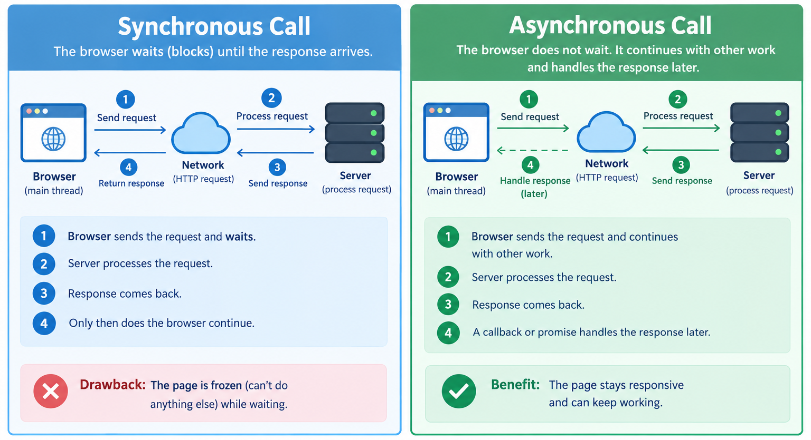
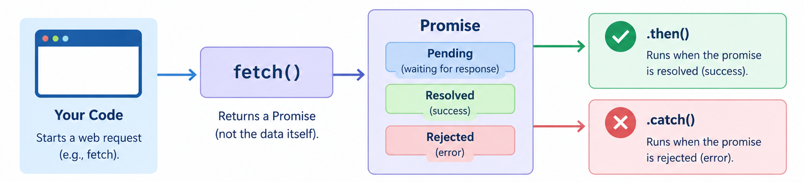

# Week 7: AJAX and Asynchronous Client-Server Communication

Every client of our bookstore so far has been a Python script. That kept the HTTP traffic easy to see, but most people reach a web service through a browser. This week the browser becomes a client of the same API: a page loads once, and from then on JavaScript asks the server for JSON in the background and updates parts of the page in place.

The API doesn't change at all. What changes is who is calling it, and that brings a few new concerns: the page must stay responsive while it waits, it must show errors to a person, and it must cope with users who click twice.

## Two Ways to Update a Page

In the classic model, every interaction is a full round trip. The user clicks a link or submits a form, the server builds a complete HTML page, and the browser throws away the old page and draws the new one. Week 1's contact form worked this way.

In the AJAX model, the page loads once. After that, JavaScript sends requests itself, receives only the data it needs, and changes just the part of the page that should change.

| | Full page reload | AJAX |
|---|---|---|
| Who sends the request | The browser, on a link or form submit | JavaScript code |
| What comes back | A complete HTML page | Usually JSON |
| What the user sees | The page blanks and redraws | One part of the page updates |
| Typed text, scroll position | Lost unless the server rebuilds them | Kept |

AJAX stands for Asynchronous JavaScript and XML. The term was coined in 2005 to describe what Gmail and Google Maps were doing with a browser object called `XMLHttpRequest`. XML was the expected format then; JSON replaced it because JavaScript reads JSON natively. The name stuck, and today it means any background HTTP request made from page JavaScript, usually with the newer `fetch()` function.

## Synchronous vs Asynchronous

A synchronous call blocks: the caller waits until the answer arrives. Our Python clients work this way. `requests.get(...)` doesn't return until the response comes back, and the script does nothing else in the meantime.

A page can't work like that. JavaScript in a browser tab runs on a single thread, the same thread that handles clicks, scrolling, and typing. If it sat waiting two seconds for `/api/stats/`, the tab would freeze for two seconds. So browser requests are asynchronous: JavaScript starts the request, carries on, and gets called back when the response arrives.



The browser manages this with a queue of jobs, the FIFO queue from your data structures course. JavaScript runs one job to completion, then takes the next one. When a response arrives, the browser adds "handle this response" to the back of the queue. Code that waits for the network never interrupts other code; it runs later, as its own job.

### Promises and async/await

`fetch()` doesn't return the response, because the response doesn't exist yet. It returns a promise: an object that stands in for a future value. A promise starts pending and later becomes fulfilled (with a value) or rejected (with an error).

`async` and `await` let you write code that uses promises as if it were ordinary step-by-step code:

```js
async function countBooks() {
  try {
    const response = await fetch("/api/v2/books/");
    const books = await response.json();
    console.log(books.length, "books");
  } catch (error) {
    console.log("network error", error);
  }
}
```

`await` pauses only the function it appears in until the promise settles. The rest of the page keeps running. An `async` function itself returns a promise, so other code can call it without waiting, or `await` it if it needs the result.



## The Fetch API

`fetch(url, options)` sends one HTTP request; with no options it sends a GET. Everything we did with `requests` in Python has an equivalent:

| Python `requests` | JavaScript `fetch` |
|---|---|
| `requests.get(url)` | `await fetch(url)` |
| `requests.post(url, json=data)` | `await fetch(url, { method: "POST", headers: { "Content-Type": "application/json" }, body: JSON.stringify(data) })` |
| `r.status_code`, `r.ok` | `response.status`, `response.ok` |
| `r.headers.get("X-Cache")` | `response.headers.get("X-Cache")` |
| `r.json()` | `await response.json()` |
| `requests.Session()` keeps cookies | The browser keeps cookies for you |

Two details trip almost everyone up.

First, `fetch` rejects only when no response arrives at all, for example when the server is down. A 404 or a 500 is still a response, so `fetch` succeeds and hands you a response whose `ok` is false. Always check `response.ok`. This is the same lesson as Week 4: check the status and the `Content-Type` before calling `.json()`.

Second, reading the body is asynchronous too, so `response.json()` needs its own `await`.

Because the v2 API sends prices as JSON numbers (Week 6's `COERCE_DECIMAL_TO_STRING: False`), JavaScript receives real numbers and can call `price.toFixed(2)`. If the contract had quietly switched prices to strings, that call would fail on every page using the API. Contracts matter in the browser too.

## Cookies, Origins, and CSRF

The browser stores cookies and sends them automatically. By default, `fetch` includes cookies whenever the request goes to the page's own origin. An origin is the scheme, host, and port together, so `http://127.0.0.1:8000` and `http://localhost:8000` are different origins even though they are the same machine.

The browser also lets a page read responses only from its own origin, unless the other server opts in with CORS (Cross-Origin Resource Sharing) headers. This rule is enforced by browsers, not servers, which is why none of our Python clients ever ran into it. We avoid the whole question this week by serving our page from the same Django project as the API. Everything is same-origin, and any session cookie the API relies on goes along automatically.

Automatic cookies have a downside. A malicious page could make your browser send a POST to a site where you are logged in, and your session cookie would go along with it. That's cross-site request forgery (CSRF). Django's defense pairs a `csrftoken` cookie with a copy of the token sent in the request. In a normal Django form, `` puts the token in a hidden field. With AJAX, JavaScript copies that same token into an `X-CSRFToken` header. A page on another origin can't read our page or our cookie, so it can't produce the token. Week 8 looks at CSRF and the views we marked `csrf_exempt` in more depth; this week we simply send the header the way a correct client should.

## Designing for Latency

On your laptop the API answers in milliseconds. On a phone with a weak signal, the same request can take seconds, and users keep doing things while they wait. Good AJAX code plans for that:

- Show that something is happening, such as a "Loading..." line, so the user knows their click registered.
- Let independent requests finish independently. If the book list is fast and the stats are slow, show the books as soon as they arrive.
- Show errors the user can act on. DRF's 400 responses list problems per field, for example `{"price": ["A valid number is required."]}`, so the page can say exactly which box is wrong.
- Prevent repeats. A user who sees no reaction clicks again, and a double-clicked "Add book" sends two POSTs. Week 6 showed that POST isn't idempotent, so the database keeps both. Disabling the button while the request is in flight stops the common case. It can't stop a script or a second tab from repeating the request, so the full fix belongs on the server.

AJAX is still request and response: the browser asks, the server answers. When the server needs to push news to the page first, the options are polling (repeating a normal request every few seconds), Server-Sent Events (one long response the server keeps writing to). Polling uses exactly the code we write this week and is often enough.

## AJAX in MVC, N-Tier, and SOA Terms

In Week 2, Django did all the work: it chose the data, rendered the template, and sent finished HTML. With AJAX, the View moves into the browser. Django sends one nearly empty page and a JavaScript file; from then on JavaScript is the presentation tier, and the server speaks only JSON.

In SOA terms, the browser has joined our list of service consumers, next to `rest_client.py` and `db_client.py`. The provider didn't need to change. That's the Week 3 idea of a service contract once more: an API built for scripts serves a web page without a single new endpoint.

## Exercise 1: The Catalog in a Web Page

Week 6 moved the bookstore onto a database and left us with a working, database-backed API. Now we give that API its first browser client: one page whose JavaScript fetches the books from `/api/v2/books/` and the stats from `/api/stats/`. No endpoint changes. We only add a page.

Open a terminal in the `bookstore` project folder (the one with `manage.py`) and activate your virtual environment. The steps use Chrome or Edge; Firefox has the same tools under slightly different names.

### Step 1: Pick up where Week 6 ended

Week 6's last step left a duplicate Two Scoops of Django in the database. Stop the server if it is running (Ctrl+C) and reset the data the way Week 6 suggested:

```bash
python manage.py flush --no-input
python manage.py seed_books
```

The last line of the output:

```text
Total books in database: 3
```

`flush` also resets the ID counter, so the next new book gets ID 4. Stopping the server first clears the stats cache, which lives in the server's memory.

### Step 2: Add a page view and its URL

Create `catalog/page_views.py`:

```python
# catalog/page_views.py
from django.shortcuts import render


def shop_page(request):
    return render(request, "catalog/shop.html")
```

The view sends one HTML page with no data in it. Everything the user sees will arrive later through the API.

Open `bookstore/urls.py` and add the import and the `shop/` line. The file should look like this:

```python
# bookstore/urls.py
from django.contrib import admin
from django.urls import include, path

from catalog.page_views import shop_page

urlpatterns = [
    path("admin/", admin.site.urls),
    path("shop/", shop_page),
    path("", include("catalog.urls")),
    path("api/", include("catalog.rest_urls")),
]
```

The page lives at `http://127.0.0.1:8000/shop/`, on the same origin as `/api/`, so the browser will let it call the API freely.

### Step 3: Write the page template

Create the folders and the file `catalog/templates/catalog/shop.html`:

```html
{# catalog/templates/catalog/shop.html #}

<!DOCTYPE html>
<html lang="en">
<head>
  <meta charset="utf-8">
  <title>Bookstore</title>
  <script src="" defer></script>
</head>
<body>
  <h1>Bookstore</h1>
  <p id="status">Loading books...</p>
  <ul id="book-list"></ul>

  <h2>Catalog stats</h2>
  <p id="stats">Loading stats...</p>
  <button id="refresh-stats">Refresh stats</button>
</body>
</html>
```

The list body is empty and both paragraphs say "Loading...". The `id` attributes are hooks for the JavaScript. `` builds the URL of the script file, and `defer` tells the browser to run the script only after the page has been parsed, so every element exists when the code looks for it.

### Step 4: Write the JavaScript

Create the folders and the file `catalog/static/catalog/shop.js`. Django's development server serves anything under an app's `static/` folder automatically.

```js
// catalog/static/catalog/shop.js
async function getJSON(url) {
  const response = await fetch(url);
  const data = await response.json();
  if (!response.ok) {
    throw new Error(`Error ${response.status}: ${data.detail}`);
  }
  return data;
}

async function loadBooks() {
  const status = document.getElementById("status");
  const list = document.getElementById("book-list");
  try {
    const books = await getJSON("/api/v2/books/");
    console.log("3. books arrived");
    list.replaceChildren();
    for (const book of books) {
      const item = document.createElement("li");
      item.textContent = `${book.title} by ${book.author}, $${book.price.toFixed(2)}`;
      list.append(item);
    }
    status.textContent = `${books.length} books loaded.`;
  } catch (error) {
    status.textContent = error.message;
  }
}

async function loadStats() {
  const stats = document.getElementById("stats");
  stats.textContent = "Loading stats...";
  try {
    const data = await getJSON("/api/stats/");
    console.log("4. stats arrived");
    stats.textContent = `${data.count} books, average $${data.average_price.toFixed(2)}, ${data.in_stock} in stock`;
  } catch (error) {
    stats.textContent = error.message;
  }
}

console.log("1. script running");
loadBooks();
loadStats();
console.log("2. requests sent, script finished");

document.getElementById("refresh-stats").addEventListener("click", loadStats);
```

`getJSON` is the browser version of `requests.get(url).json()`, plus the check that `fetch` doesn't do for us. If the status isn't in the 200s, it throws an error built from the `detail` message in the API's error body, so every caller handles a 404 and a dead server in the same `catch`. (If the server ever answered with an HTML error page instead of JSON, `response.json()` itself would throw, and you would see that message instead.)

`loadBooks` asks for the books and adds one list item per book. `replaceChildren()` empties the list first, so calling it again redraws rather than appends. `createElement("li")` makes a new item, `textContent` puts the text in as plain text, and `append` adds it to the page. `book.price.toFixed(2)` works because v2 sends prices as JSON numbers. `loadStats` does the same for the stats endpoint.

At the bottom, `loadBooks()` and `loadStats()` are called without `await`. Each starts its request and returns immediately, so the script finishes before either response arrives.

### Step 5: Load the page and read the console

Start the server with `python manage.py runserver`, open Chrome, press F12, choose the Console tab, and visit `http://127.0.0.1:8000/shop/`.

The list fills almost at once and the status line reads `3 books loaded.` 
```text
Django 5 by Example by Antonio Mele, $49.99
Fluent Python by Luciano Ramalho, $59.99
Clean Code by Robert C. Martin, $39.99
```
The stats line says `Loading stats...` for about two seconds, then:

```text
3 books, average $49.99, 2 in stock
```

The console shows:

```text
1. script running
2. requests sent, script finished
3. books arrived
4. stats arrived
```

Line 2 appears before line 3: the script finished while both requests were still out. The stats arrive two seconds later because `compute_stats()` deliberately sleeps on a cache miss, and the list didn't wait for them. Each request updated its own part of the page as soon as its answer came back.

Click Refresh stats. The same line comes back almost instantly, because the stats endpoint now has its answer cached on the server.

### Step 6: Watch the traffic in the Network tab

Open the Network tab, click the Fetch/XHR filter, and reload the page. You'll see two requests, `books/` and `stats/`. Click `books/`: Headers shows a plain `GET /api/v2/books/` with status 200, the same request `db_client.py` sent in Week 6, and Response shows the JSON. The page itself arrived first; the data followed once the script ran.

### Step 7: Two kinds of failure

In the Console, paste this line and press Enter:

```js
await getJSON("/api/v2/books/99/")
```

The console prints a red error:

```text
Uncaught Error: Error 404: Book not found.
```

`fetch` didn't fail here. The server answered with a 404, so `fetch` returned a response with `ok` set to false, and `getJSON` turned it into an error. The message is the 404 body Week 6 was careful to keep.

Now stop the server with Ctrl+C, leave the page open, and click Refresh stats:

```text
Failed to fetch
```

This time no response arrived, so `fetch` itself failed. (Firefox words it as `NetworkError when attempting to fetch resource.`) Restart the server before moving on.

## Exercise 2: Adding Books from the Page

Now the page sends data. We'll add a small form that creates books through v2 without reloading the page, show the API's validation errors, and then return to Week 6's open problem: a POST sent twice saves the book twice. This time the cause will be a double click.

### Step 1: Add the form to the template

Open `catalog/templates/catalog/shop.html` and add this just above `</body>`:

```html
  <h2>Add a book</h2>
  <form id="add-form">
    
    <input name="title" placeholder="Title">
    <input name="author" placeholder="Author">
    <input name="price" placeholder="Price">
    <button type="submit">Add book</button>
  </form>
  <p id="form-message" style="white-space: pre-line"></p>
```

`` adds a hidden input holding Django's CSRF token. Our JavaScript will copy it into a header. The inputs have no browser validation, so bad input reaches the server, which is the check nobody can skip. `white-space: pre-line` lets the message show one error per line.

### Step 2: Send the form with fetch

Add this to the end of `catalog/static/catalog/shop.js`:

```js
async function addBook(event) {
  event.preventDefault();
  const form = event.target;
  const button = form.querySelector("button");
  const message = document.getElementById("form-message");
  button.disabled = true;
  message.textContent = "Saving...";
  try {
    const response = await fetch("/api/v2/books/", {
      method: "POST",
      headers: {
        "Content-Type": "application/json",
        "X-CSRFToken": form.elements.csrfmiddlewaretoken.value,
      },
      body: JSON.stringify({
        title: form.elements.title.value,
        author: form.elements.author.value,
        price: form.elements.price.value,
      }),
    });
    const data = await response.json();
    if (response.ok) {
      message.textContent = `Added "${data.title}" with ID ${data.id}.`;
      form.reset();
      loadBooks();
      loadStats();
    } else {
      message.textContent = Object.entries(data)
        .map(([field, problems]) => `${field}: ${problems.join(" ")}`)
        .join("\n");
    }
  } finally {
    button.disabled = false;
  }
}

document.getElementById("add-form").addEventListener("submit", addBook);
```

`event.preventDefault()` stops the browser's normal form submit, which would reload the whole page, and lets our code send the data instead. That one line is the difference between a Week 1 form and an AJAX form.

The `fetch` call is the browser version of `requests.post(url, json=...)`: method, headers, and a body built with `JSON.stringify`. `Content-Type: application/json` tells DRF how to read the body, and `X-CSRFToken` carries the token from the hidden input. The price goes as typed; DRF turns `"44.95"` into a decimal and rejects anything that isn't a number.

On success, the page clears the form and calls `loadBooks()` and `loadStats()` again, so the new book and the new stats appear without a reload. On a 400, DRF's body maps each field to a list of messages, and the `map` turns each pair into one line of text.

The button is disabled while the request is in flight and re-enabled in `finally`, which runs whether the request succeeded, was rejected, or never reached the server.

### Step 3: Try the form

Reload `/shop/` with Ctrl+F5 so the browser fetches the new script. Click Add book with every box empty:

```text
title: This field may not be blank.
author: This field may not be blank.
price: A valid number is required.
```

Type `Two Scoops of Django`, `Daniel and Audrey Feldroy`, and `-5`, then submit:

```text
price: Ensure this value is greater than or equal to 0.
```

Both messages come from Week 6's `BookSerializer`; the page just displays them. Change the price to `44.95` and submit again:

```text
Added "Two Scoops of Django" with ID 4.
```

The new book appears without a page reload. The stats line goes back to "Loading stats..." and two seconds later shows:

```text
4 books, average $48.73, 3 in stock
```

The POST cleared the cached stats, so this request recomputed them: (49.99 + 59.99 + 39.99 + 44.95) / 4 = 194.92 / 4 = 48.73, with three of four books in stock. In the Network tab, click the POST to `books/`. Its Payload is the JSON body, and its response is the same 201 that `db_client.py` received in Week 6.

### Step 4: Text stays text

Add a book titled `<b>Not bold</b>` by `Tester` for `1`. It appears with the angle brackets visible, because `loadBooks` inserts values with `textContent`. With `innerHTML` the title would be bold, and a nastier title could run a script.

### Step 5: Break it on purpose: the double click

At the end of Week 6, running a client twice saved a duplicate book. In a browser, all it takes is a double click. To see it, we need a slow network, because on localhost the first request finishes before the second click lands.

1. In `shop.js`, comment out the line `button.disabled = true;` and press Ctrl+F5 on `/shop/`.
2. In the Network tab, open the throttling menu (it says No throttling) and choose 3G. Older Chrome versions call it Slow 3G.
3. Fill in `Refactoring`, `Martin Fowler`, and `47.99`, and double-click Add book.

Two POSTs appear in the Network tab. Refactoring appears twice in the list (the success message shows IDs 6 and 7). Each click submitted the form, and both read it before either request finished.

Restore `button.disabled = true;`, reload, and double-click Add book with another title. Only one POST goes out: the first click disables the button before the request leaves, so the second click does nothing. Set throttling back to No throttling.

The disabled button fixes the double click, not the problem underneath it. A script, a browser retry, or a second tab can still send the same POST twice, and the server will save both. Week 6's open question (a unique constraint, a check before inserting, or an idempotency key) is still the real fix, and it belongs on the server. The client makes mistakes unlikely; only the server can make them impossible.

To reset, stop the server and run `python manage.py flush --no-input` followed by `python manage.py seed_books`.

## Bonus Activity (Ungraded, At Home)

1. Add to cart. Give each list item an "Add to cart" button that POSTs `{"book_id": ...}` to `/api/cart/` (send the same two headers as `addBook`), and show the cart total returned by the response. Reload the page: the cart is still there. Find the `sessionid` cookie in the request headers in the Network tab, and explain why the page never had to send it explicitly.
2. Live search. Make `BookListAPI.get` accept an optional `?search=` parameter that filters with `title__icontains`, then add a search box whose `input` event reloads the list with `/api/v2/books/?search=` plus the text. To avoid a request on every keystroke, cancel the previous timer with `clearTimeout` and start a new one with `setTimeout(..., 300)`, so the request goes out only when the user pauses.

Something to think about: suppose the page moved to its own server at `http://localhost:3000` while the API stayed on port 8000. Which request would fail first, and why would the same request still work from `db_client.py`?

## References

- Django 5 by Example: Build Powerful and Reliable Python Web Applications from Scratch
  - Chapter 6: Sharing content on your website
  - Chapter 9: Managing payments and orders
  - Chapter 10: Extending your shop

- Django Software Foundation. (n.d.). How to use Django's CSRF protection. [Django documentation](https://docs.djangoproject.com/en/stable/howto/csrf/). 
